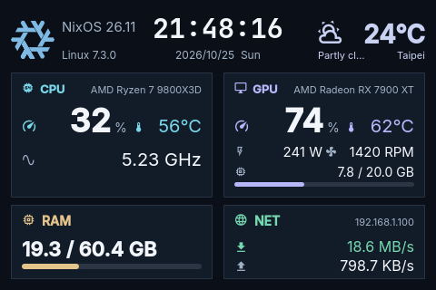

# Turing Screen

原生跨平台 USB 副屏软件，版本 0.2.0，使用 C++17。运行时不依赖 Rust 或 Python。目标设备为 35inchNEW / Rev A 的 320×480 副屏。

本版优先降低常驻内存和 CPU。默认每秒采集、渲染并更新副屏；隐藏窗口时停止预览绘制，串口工作线程空闲时阻塞等待，只保留最新待发送帧，并仅发送变化矩形。用户已设置的其他刷新间隔会保留。

## 使用

- Windows：完整解压 Windows 压缩包，运行 `turing-screen-qt.exe`。旁边的 DLL、plugins、assets 必须保留。
- Linux：解压后运行 `./run.sh`。预编译包采用 Arch Linux / glibc 2.44 构建；其他发行版建议从源码编译。桌面需提供 X11 或 Wayland 及相应图形系统库；音量需要正在运行的 PulseAudio 或 PipeWire-Pulse 服务。
- Nix / NixOS：在源码目录执行 `nix run path:.`，或用 `nix build path:.` 构建。包自带运行资源与桌面入口，详见下方 Nix 说明。
- 首次自动跟随系统语言；“设置”可选中文 / English、四种配色、采样间隔、分区及关闭到托盘。
- 未连接硬件也能预览、编辑和采集本机数据。连接串口后点击“应用到副屏”开始发送。
- 可拖动原生标题栏、拖动边框缩放、最大化。状态栏或托盘的“退出”结束进程。“关闭到托盘”需要桌面提供托盘服务；没有托盘时关闭窗口正常退出。

## 功能

- 单一“主题”入口，预览 / 编辑切换；主题库缩略图、搜索和尺寸；传感器、设置、诊断独立页面。
- 导入 36 个随附官方 `.data` 主题及此前 Rust 版本的 JSON；保存为主题 JSON，导出 PNG。
- 文字、传感器、图片、矩形、椭圆、直线、状态条、弧形条、分组；CPU / GPU / RAM / 网络 / 时钟 / 磁盘组件模板。
- 树状分组、重命名、嵌套拖拽、可见 / 锁定、复制 / 粘贴 / 复制图层、编组 / 解组、置顶 / 置底、框选和 Ctrl 多选。
- 画布移动、右下角缩放、方向键微调、Shift 加速、网格、吸附、适应窗口 / 1:1 / 缩放。
- 位置、尺寸、文字、指标绑定、字号、颜色属性；撤销 / 重做（最多 30 步，当前文档历史约 8 MiB 预算）。
- 原生串口、方向、镜像、亮度、清屏、休眠、唤醒、复位，连接 / 采集 / 发送三种独立状态。
- CPU 使用率 / 频率 / 型号、内存、分区、网络速率、日期时间。内存分别显示已用、可用、总量的 GB 数值；默认 RAM 组件同时显示百分比及“已用 / 总量 GB”。GB 与原主题保持一致，按 1024³ 字节换算；总量为操作系统报告的可用物理内存，不包含硬件保留部分。
- Linux 通过 [amdgpu 的 sysfs / hwmon 接口](https://docs.kernel.org/gpu/amdgpu/thermal.html)读取 AMD GPU 使用率、温度、频率、功耗、风扇转速、电压，以及显存已用 / 可用 / 总量和使用率。多卡时优先 `boot_vga` 主显卡，其次选择显存较大的卡；不依赖 `card0` 编号。
- Linux 通过 hwmon 读取 CPU 温度、带明确标签的 CPU 风扇 / 水泵 / 电压；功耗优先使用 CPU hwmon，或通过 RAPL 包能量差计算。驱动没有暴露的项目、不可读的能量接口不会编造数据，传感器页及诊断 JSON 显示缺失原因。RAPL 首次需要两次有效采样；部分内核仅允许 root 读取其能量接口，应用不更改系统权限。
- Linux 读取所选分区对应磁盘的 NVMe / drivetemp 温度，支持分区和 device-mapper 的底层设备；多个底层设备取最高温度。驱动未提供温度的 SATA 磁盘显示不可用。
- 系统默认输出音量：Linux 使用原生 libpulse 异步查询，兼容 PulseAudio / PipeWire-Pulse；Windows 使用 Core Audio。跟随默认设备及静音状态，静音显示 0%，超过 100% 的音量保留实际数值，进度条限制在 100%。不会启动外部音量查询进程或修改系统音量。
- 天气可在设置中开启并填写城市，留空使用 ipwho.is 按 IP 粗略定位（代理可能影响位置）。数据来自 [Open-Meteo](https://open-meteo.com/)，每 10 分钟更新；失败后退避重试，缓存最多保留 30 分钟。Nightfall 在未明确关闭天气时默认启用，其余主题默认关闭。城市名、温度、天气状况与天气图标可分别绑定；天气文字使用英文，图标随当前天气变化。
- `LocalIp` 显示活动网卡的本机 IP，优先 IPv4 和默认路由网卡；没有 IPv4 时使用非链路本地 IPv6。地址随采样更新，来源中记录网卡名，无可用地址时显示 `--`。

Windows GPU 采集、NVIDIA / Intel GPU 采集、Windows 硬件温度 / 风扇助手尚未实现；Linux 未由驱动提供的传感器也无法在应用中直接获取。随附主题中的 CPU / GPU 风扇、CPU 功耗、显存使用率等指标已注册，可在属性中绑定。音量兼容旧主题 `VulomeLoad` 及 `VolumeLoad` 名称。Windows / Linux 支持设置中的登录自启动，NixOS 也支持下文的声明式 systemd 模块；其他精简范围：GIF 动画、Photoshop 高级图像处理。官方 `.data` 只读导入；修改保存为独立 JSON。

## 夜航主题与组合编辑

主题库内置 Nightfall，480×320 横屏，文件位于 [assets/themes/nightfall.json](assets/themes/nightfall.json)。顶部左侧为随系统切换的图标及左对齐的系统 / 内核版本，中间以随附 JetBrains Mono 等宽字体显示时间，右侧天气无独立背景：天气状况在图标下方、与图标左边缘对齐，温度下方为右对齐的城市，天气状况与城市位于同一排。下方为 CPU、GPU、RAM、NET 四块信息区域，其余文字使用随附 Inter 字体，同行文字使用统一固定基线，图标对齐该行。

文字全局按字体行度量定位，底部 / 垂直居中均不再依据当前字符串的轮廓计算；`Ryzen` 的下伸字母及变化的读数不会使整段文字上下移动。夜航的各行文字显式指定图层内 `baseline`，不同字号也共用同一行基线，并预留下伸字母的空间。

系统图标区域为 48×48 像素，版本文字与图标留有间距；系统版本最大字号为 15，长系统名和内核号在各自区域内自动缩小字号，保持固定基线并避免遮挡时钟。

CPU / GPU 图标及标签在标题行左侧，固定型号 `AMD Ryzen 7 9800X3D` / `AMD Radeon RX 7900 XT` 在右侧；可在图层中编辑文字。使用率 / 温度行上移，CPU 主频在该行下边缘至面板内边距下边缘之间垂直居中。GPU 不显示主频，功耗与风扇同排，显存 GB 单独一行、下方为用量条，不显示显存百分比。RAM 显示已用 / 总量 GB 和用量条，不显示百分比；网络标题为镂空地球 Unicode 图标及 NET，右侧本机 IP 使用 11 像素、右对齐，上下行数值均为 16 像素、速率自动选择单位。无音量、磁盘状态栏或 NIGHTFALL 标识。所有字体和 Unicode 图标均随程序提供，缺失数值保持 `--`，天气尚未加载时不显示图标。

`OsIcon` / `OsName` / `KernelVersion` 在 NixOS 显示 NixOS 图标、版本及 Linux 内核；Windows 显示 Windows 图标、精简系统名（例如 `Windows 11 26H2`，不带 Pro / Home）及 NT 内核版本。发行版本从本机注册表 `DisplayVersion` 读取，未提供时不添加猜测的发行标签；内核从 [QSysInfo 系统接口](https://doc.qt.io/qt-6/qsysinfo.html#kernelVersion)读取，可取得且构建号一致时附带更新修订号。Windows 发布脚本包含 [Schannel TLS 插件](https://doc.qt.io/qt-6/ssl.html)，供天气 HTTPS 使用。当前修订的 Windows 系统名 / 图标 / 布局已通过模拟数据检查，尚未在 Windows 实机复测；GPU 与硬件传感器采集限制见上文。



[Windows 系统区预览（模拟示例数据）](docs/images/nightfall-windows-preview.png)

- 普通点击 / 拖动选中整个组合；已在图层树中选中的组合不会被内部子图层替换。完整框选也会选择组合整体。
- Alt+单击或双击可选择内部图层，图层树也能精确选择子图层；随后可以单独移动和调整大小。组合自身不显示无效的缩放手柄。
- 「主题方向」在未连接副屏时也可设置。四种方向按主题分别自动记忆，切换或重启后恢复；保存 / 另存为的 JSON 同时携带 `orientation`（0：竖屏，1：反向竖屏，2：横屏，3：反向横屏）。另存为副本后可以独立设置方向，旧版全局方向会迁移到当时选中的主题。
- 夜航各区域都是可编辑组合。修改内置主题后保存会另存为个人 JSON，不覆盖随附原版。
- 主题库新增「删除」按钮，也可右键主题或使用「主题选项 → 删除主题」。删除前会说明影响，有未保存修改时会提示。
- 个人主题文件移入数据目录的 `deleted-themes`，需要找回时可把文件移回 `themes` 目录；外部导入主题仅移除引用，保留源文件。内置主题移除后可通过右键菜单或主题选项中的「恢复内置主题」找回。
- 删除当前主题后暂停副屏发送并回到系统概览；对应草稿、撤销记录和方向设置一并清理，其他主题不受影响。文件或配置写入失败时保留当前文档，已移动的文件会尝试还原。

开发时可运行 `python3 scripts/generate-dashboard-theme.py` 重建主题。图标字体由 `scripts/generate-symbol-font.py` 从 JetBrainsMono Nerd Font 3.5 的指定字形裁剪、更名，Inter 字体由 `scripts/generate-latin-font.py` 从 Inter 4.1 裁剪、更名，时钟字体由 `scripts/generate-mono-font.py` 从 JetBrainsMono Nerd Font Bold 裁剪 ASCII 并更名；字体生成步骤需 fontTools，运行程序无需 Python。

## 快捷键

| 操作 | 快捷键 |
|---|---|
| 新建 / 导入 / 保存 / 另存为 | Ctrl+N / Ctrl+O / Ctrl+S / Ctrl+Shift+S |
| 撤销 / 重做 | Ctrl+Z / Ctrl+Y（跟随平台习惯） |
| 重命名 | F2 或树状列表双击 |
| 复制 / 剪切 / 粘贴 | Ctrl+C / Ctrl+X / Ctrl+V |
| 复制图层 / 编组 / 解组 | Ctrl+J / Ctrl+G / Ctrl+Shift+G |
| 新建文字图层 | Ctrl+Shift+N |
| 微调 / 快速微调 | 方向键 / Shift+方向键 |
| 选择组合内图层 | Alt+单击 / 双击 |
| 缩放 | Ctrl+滚轮 |

## 编译

需要 CMake ≥3.21、C++17 和 Qt ≥6.4 的 Core、Gui、Widgets、Network；测试另需 Qt Test。Linux 另需 pkg-config 和 libpulse 开发文件（Debian/Ubuntu：`libpulse-dev`；Arch：`libpulse`；Nix：`libpulseaudio`）。串口使用 Win32 / POSIX，不依赖 QtSerialPort。

```powershell
./scripts/build-windows.ps1 -QtRoot C:/Qt/6.8.0/msvc2022_64
./scripts/package-windows.ps1 -QtRoot C:/Qt/6.8.0/msvc2022_64
```

```sh
./scripts/build-linux.sh
./scripts/package-linux.sh
```

`build/linux/turing-screen-qt --dump-sensors` 输出实时采样、来源和不可用原因，方便排查驱动或权限问题。加 `--weather-city "Taipei, Taiwan"` 可测试天气（等待最多 20 秒，不写入设置）。

本机验证使用 Windows 11 / Qt 6.8.0 / MSVC 2022 和 WSLg Arch Linux / Qt 6.11.1 / GCC 16。Windows 默认使用 GDI 字体后端，减少本环境中 DirectWrite 首次绘制的内存开销；仍可用 `QT_QPA_PLATFORM` 显式覆盖。

GitHub Actions 的 [Build and test](.github/workflows/ci.yml) 在 push、pull request 和手动触发时，使用 Qt 6.8.3 分别在 Ubuntu 24.04 / GCC 与 Windows Server 2022 / MSVC 上执行 Release 构建、core / GUI / startup 测试和 Nightfall 示例渲染。测试报告、日志和预览图作为 artifacts 保留 7 天；不包含 Nix 检查。

## 开机启动

设置中的「开机启动（登录后） / Start at sign-in」读取系统中的持久启动状态，开启后在下次登录图形桌面时启动。开关异步更新，失败时显示原因并回读实际状态；关闭不会停止当前程序或中断副屏发送。不在每次程序启动时自动重写启动项。

- Windows：添加或移除当前用户 `HKCU\Software\Microsoft\Windows\CurrentVersion\Run` 下的 `TuringScreen` 项，无需管理员权限。命令保留当前数据目录，对含空格的路径转义；命令超过 Windows Run 的 260 字符限制时报告错误，不写入无效项目。实现依据 [Microsoft Run 启动项文档](https://learn.microsoft.com/en-us/windows/win32/setupapi/run-and-runonce-registry-keys)。
- Linux：使用 `turing-screen.service` systemd 用户服务，在 `graphical-session.target` 启动，图形会话结束时停止。没有现有服务时写入 `$XDG_CONFIG_HOME/systemd/user/`（默认 `~/.config/systemd/user/`）；优先复用 NixOS 等已安装服务，避免重复启动。安装目录包含 `run.sh` 或 Nix Qt 包装器时使用对应启动入口。普通发行版需要 systemd 用户管理器，以及已向其导入图形会话环境的桌面。
- 关闭 Linux 自启动时禁用用户启用关系，并创建用户级屏蔽，覆盖 NixOS `/etc/systemd/user` 中的启用关系；重新开启移除屏蔽。不会启停当前服务，也不会修改 Nix store 或系统级单元。临时运行实例不影响持久启动状态的判断。通过 Home Manager 或手工直接管理同一用户级单元文件时，开关只读并提示在原配置中修改，保留其内容。相关语义见 [systemctl](https://www.freedesktop.org/software/systemd/man/latest/systemctl.html)。

移动或删除手动安装的程序后，应在新位置重新开启自启动来更新路径。NixOS 声明式管理的服务保留其原有参数和启动目标；界面中的用户级屏蔽不会因一次系统重建自动消失，重新开启时会移除。

## Nix / NixOS

提供固定依赖的 `flake.nix` / `flake.lock` 和可单独 `callPackage` 的 `nix/package.nix`，声明 x86_64-linux / aarch64-linux 包；本机实际构建验证为 x86_64-linux。已启用 `nix-command`、`flakes` 的环境可在项目目录执行：

```sh
nix run path:.
nix build path:.
./result/bin/turing-screen-qt
nix flake check path:.
nix develop path:.
```

`path:.` 会包含尚未加入 Git 的新增源码，适合直接测试当前工作区。开发环境提供 CMake、Ninja、pkg-config、Qt、libpulse、Python / fontTools 及 nixfmt，可执行 `./scripts/build-linux.sh`。Nix 包构建时运行 core / gui 功能测试，安装字体、主题、图标、桌面菜单项；使用 [Nixpkgs 的 Qt 包装钩子](https://nixos.org/manual/nixpkgs/unstable/#sec-language-qt)配置 X11 / Wayland 插件，资源保存在包内 `share/turing-screen`。

加入 NixOS 或 Home Manager 的 flake 时，可将项目设为输入，并复用已有 nixpkgs：

```nix
inputs.turing-screen = {
  url = "path:/absolute/path/to/turing-smart-screen-qt";
  inputs.nixpkgs.follows = "nixpkgs";
};
```

随后将 `inputs.turing-screen.packages.${pkgs.stdenv.hostPlatform.system}.default` 加入 `environment.systemPackages` 或 `home.packages`。串口访问沿用当前用户的设备权限。

需要由 systemd 管理开机自启动时，在 `nixosSystem` 的 `modules` 中导入随包的 NixOS 模块并启用服务：

```nix
modules = [
  ./configuration.nix
  inputs.turing-screen.nixosModules.default
  {
    services.turing-screen.enable = true;
  }
];
```

模块自动安装应用并生成 `turing-screen.service` 用户服务。登录图形桌面时启动，退出图形会话时停止；异常退出后等待 5 秒重启，正常退出保持停止。程序以登录用户身份运行，沿用该用户的主题、设置、音频服务及设备权限。此处使用 [systemd 图形会话目标](https://www.freedesktop.org/software/systemd/man/latest/systemd.special.html#graphical-session.target)，适用于已将会话环境导入 systemd 的桌面，包括启用 systemd 集成的 Hyprland / UWSM。

可选设置：`services.turing-screen.package` 覆盖包，`extraArgs` 设置参数列表，`systemd.target` 选择会话目标（默认 `graphical-session.target`）。例如在 Hyprland 会话目标存在时可设为 `hyprland-session.target`；服务仍随图形会话结束而停止。需要固定主题时可设置：

```nix
services.turing-screen.extraArgs = [ "--theme" "/home/user/themes/nightfall.json" ];
```

重建配置后，可以用以下命令管理服务；启用关系由 NixOS 配置声明，无需另行 `systemctl enable`：

```sh
systemctl --user start turing-screen.service
systemctl --user status turing-screen.service
systemctl --user restart turing-screen.service
systemctl --user stop turing-screen.service
journalctl --user -u turing-screen.service -b
```

将 `services.turing-screen.enable` 改为 `false` 并重建，可取消自动启动。服务启动应用并读取上次使用的主题；副屏连接及发送仍按界面操作。

## 验证与数据

轻量模式可在「设置 / Settings」中立即进入，也可启用「关闭主窗口后自动进入轻量模式」，设置 1–86400 秒的倒计时（默认 60 秒，自动进入默认关闭）。关闭主窗口后先收起到托盘并开始计时；重新打开窗口会取消计时。需要系统托盘宿主；没有托盘时不会自动隐藏并销毁唯一的操作入口。

进入轻量模式会销毁原生主窗口、编辑控件、主题库及缩略图，释放 UI 绘制资源。采集、当前主题的离屏绘制和串口发送独立运行，保留主题方向、亮度、镜像与发送 / 暂停状态；没有连接设备或发送已暂停时不再执行无用的采集与渲染。只为当前主题保留需要的天气和音量服务。托盘仍可暂停 / 继续发送、恢复窗口和退出。

托盘中的「轻量模式 / Lightweight mode」与「发送数据 / Send data」使用带勾选状态的开关：勾选轻量模式释放界面，取消勾选恢复窗口；勾选发送数据开始推送，取消勾选暂停。状态与主界面同步，设备未连接时发送开关禁用，断开后自动取消勾选。

未保存的草稿、撤销 / 重做、选择和编辑状态会先暂存到数据目录的私有临时文件，恢复窗口时载入并删除该临时文件；不会自动覆盖主题源文件。暂存失败则保留编辑界面。此临时文件用于同一进程内恢复，不能替代保存主题。

`scripts/verify-windows.ps1`、`scripts/verify-linux.sh` 启动原生窗口，采样 RSS 峰值和 CPU 时间，保存七种界面截图。加 `-Stress`（Linux 第三个参数 `--stress-test`）测试主题切换、图层创建、撤销、页面切换、托盘和退出。MB 为 1,000,000 字节，包含共享库常驻页；CPU 报告包含单核比例及按逻辑核数归一化的整机比例。资源采样计时器只在测试模式启用。

当前本机 Wayland / DPR 2 对照：完整界面约 133 MB RSS，轻量模式持续向模拟副屏推送时约 66 MB，开启天气约 79 MB；Nightfall 渲染耗时减少约 30%，复杂图片主题约 52%。条件、限制与原始数据见 [性能优化和轻量模式验证](docs/performance-optimization-2026-10-25.md)。100 MB 是随附主题和基本工作流的实测目标，并非任意巨大图片、显示缩放或系统字体后端的硬性上限；当前完整高 DPI 窗口超过该目标。实体副屏发送仍需实机验证。

可用 `-DSCREEN_BUILD_PROFILING=ON` 构建独立 `screen-profile`，再运行 `python3 scripts/profile-linux.py --case nightfall,lightweight --seconds 20 --output artifacts/performance-local`。脚本默认查找 `build/profile/screen-profile`，可用 `--binary` 指定其他构建目录。探针使用独立配置，默认不连接副屏；该构建选项默认关闭，探针不随应用安装。

数据使用 Qt `AppLocalDataLocation`（Windows 通常为 `%LOCALAPPDATA%/TuringScreen/TuringScreenQt`，Linux 通常为 `~/.local/share/TuringScreen/TuringScreenQt`）；可用 `--data-dir` 指定目录。源码许可 GPL-3.0-or-later，资源见 [THIRD_PARTY.md](THIRD_PARTY.md)。
