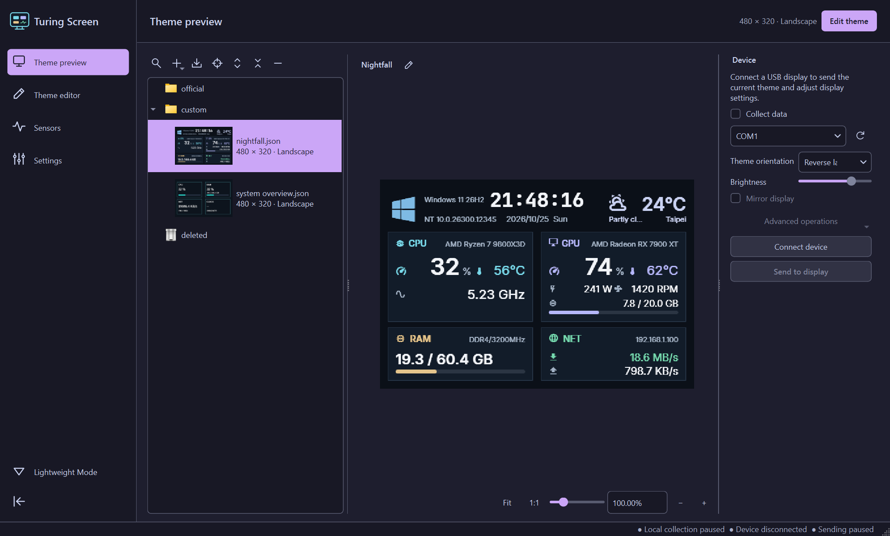
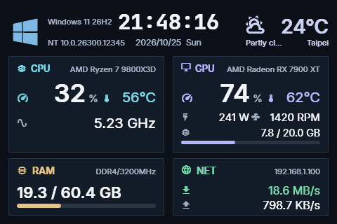

# Turing Screen

English | [简体中文](README.zh-CN.md)

A lightweight USB secondary display app for Windows and Linux. Preview and edit themes, and display your PC's system stats.

Designed for **35inchNEW / Rev A devices at 320×480 or 480×320**. Compatibility with other models is not guaranteed.

## Preview



**Nightfall** — the bundled 480×320 theme, rendered at its native resolution:



Both previews use sample sensor data. Available live readings depend on your hardware and sensor source.

## Getting started

- **Windows**: Run the installer, or fully extract the portable archive and launch `turing-screen-qt.exe`.
- **Linux**: Extract the release archive and run `./run.sh`. If the device does not connect, check that your user has permission to access the serial port.
- **Nix / NixOS**: Run `nix run path:.` from the source directory.

Keep the portable package's `assets`, runtime libraries, and plugins alongside the application.

1. Choose a theme in **Theme preview**.
2. Plug in the USB display, select its serial port in the panel on the right, and click **Connect device**.
3. Click **Send to display** to start displaying the theme. Orientation, brightness, and mirroring are also available in the right panel.

You can preview and edit themes without a connected display.

## Features

- **Themes**: Supports official `.data` themes and JSON themes. Double-click a theme to open the editor, where you can adjust text, images, layers, progress bars, and metric bindings. Undo, redo, and PNG export are supported. Edited official themes are saved as JSON.
- **Zoom**: The preview and editor provide fit-to-window, 1:1, a slider, and percentage input in the bottom-right corner. You can also zoom with Ctrl + mouse wheel.
- **Data collection**: Updates once per second by default; the interval is configurable in Settings. Turning off **Collect data** pauses updates and keeps the last frame. The switches in Settings, the device panel, and the tray menu stay in sync.
- **Lightweight mode**: Releases the editor interface and static drawing caches while continuing to update the connected display. Click the tray icon to restore the window, or choose **Exit** from the tray menu to exit.
- **Weather**: Enable weather in Settings and enter a city, or leave it blank to use IP-based location. Weather refreshes automatically every 10 minutes. You can also click **Fetch weather now**; the result or error appears next to the button. Weather requires an internet connection and data collection to be enabled.
- **Appearance and startup**: Settings lets you switch between Chinese and English, choose a color scheme, close to the tray, and enable startup at sign-in. At sign-in, the app enters lightweight mode, connects to the last-used serial port, and starts sending frames.

## Sensors

CPU usage, memory, network speed, disk space, volume, and time are available by default. Unavailable metrics show `--`; the **Sensors** page explains why.

On Windows, temperatures, live CPU frequency, and GPU data require third-party monitoring software. Choose a source under **Settings → Windows sensors**:

| Source | Setup |
| --- | --- |
| HWiNFO | Open Sensors and enable `Shared Memory Support`. |
| AIDA64 | Enable shared memory under **Hardware Monitoring → External Applications** and select the metrics you need. |
| LibreHardwareMonitor | Enable `Options → Remote Web Server → Run`. Use the same port in both applications (default: `8085`) and disable Web Server authentication. |

Install the monitoring software separately and keep it running. Available metrics depend on your hardware, drivers, and selected source.

On Linux, the app reads CPU, disk, and AMD GPU metrics directly from system drivers. NVIDIA and Intel GPU collection is not yet implemented. Volume collection requires PulseAudio or PipeWire-Pulse.

## Files and backups

Portable installations usually store themes in `assets/themes`: `official` contains official themes, `custom` contains your own themes, and `deleted` is the trash folder. If that directory is not writable, the app uses the user data directory instead.

Keep your personal theme files when replacing a portable package. Use **Open data folder** in Settings to locate `config.json`, and back up that file to preserve your settings.

## Building from source

Requires CMake ≥ 3.21, a C++17 compiler, and Qt ≥ 6.4 with the Core, Gui, Widgets, Network, Svg, and Test modules. Linux also requires Ninja, pkg-config, and the libpulse development files.

Windows with Visual Studio 2022 / MSVC:

```powershell
./scripts/build-windows.ps1 -QtRoot C:/Qt/6.8.0/msvc2022_64
```

Linux:

```sh
./scripts/build-linux.sh
```

The build scripts also run the tests. Nix users can run `nix build path:.`. Packaging scripts are in `scripts`; use the application's `--help` option to view its command-line options.

The **Build, test and package** GitHub Actions workflow generates Windows x64 portable archives and installers on pushes and manual runs. Open a workflow run and download `turing-screen-qt-<version>-windows-x64-portable.zip` from **Artifacts**. Extract the entire archive, then run `turing-screen-qt.exe`. The portable package includes Qt, the MSVC runtime, plugins, and assets. Artifacts are retained for 30 days; pull requests only run builds and tests.

See the [protocol reference](docs/protocol.md) for serial messages. The source code is licensed under [GPL-3.0-or-later](LICENSE). See [third-party materials](THIRD_PARTY.md) for fonts, themes, and other bundled resources.
